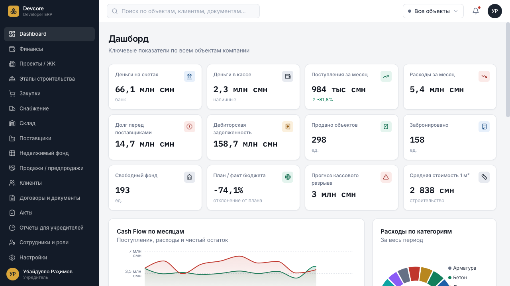
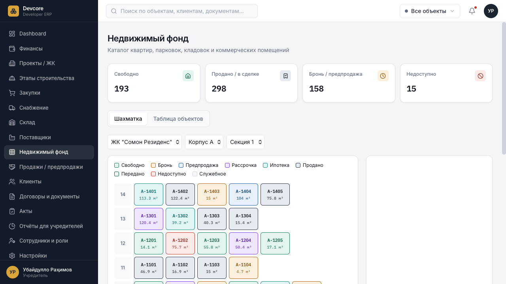
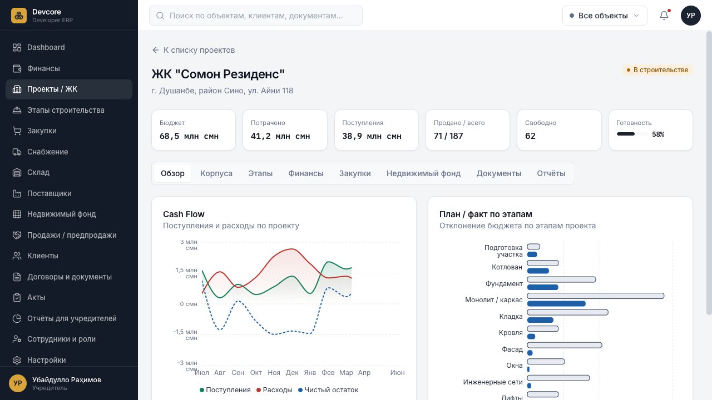

<div align="center">

# 🏗️ Devcore ERP · Developer OS

**Next-Gen Construction & Real Estate Developer ERP Platform**  
*Современная ERP-платформа для девелоперских и строительных компаний*

[](https://react.dev/)
[](https://www.typescriptlang.org/)
[](https://vitejs.dev/)
[](https://tailwindcss.com/)
[](https://www.radix-ui.com/)
[](LICENSE)
[](CONTRIBUTING.md)

[🇬🇧 English](#-english) • [🇷🇺 Русский](#-русский)

</div>

---

## 📸 Screenshots / Галерея системы

### 1. Executive Dashboard / Главный дашборд руководителя
> Сводные KPI, прогноз кассовых разрывов, ежемесячный Cash Flow, структура расходов и панель рисков.


<br/>

### 2. Interactive Real Estate Chessboard / Интерактивная шахматка помещений
> Управление квартирографией, фильтрация по секциям/этажам/статусам, карточка помещения с расчетом стоимости метра и бронированиями.


<br/>

### 3. Construction Project Management / Управление строительными проектами
> Технико-экономические показатели (ТЭП), план/факт выполнения СМР, бюджеты этапов, динамика расходов и поступлений.


---

<a name="-english"></a>
## 🇬🇧 English

### Overview

**Devcore ERP** is an enterprise-grade ERP system prototype tailored specifically for real estate developers, construction holdings, and property management enterprises. It unifies high-level financial planning, procurement supply chains, on-site construction tracking, and real estate sales inventory into a unified, lightning-fast workspace.

Built with **React 19**, **TypeScript**, **Vite 8**, and **Tailwind CSS v4**, the application functions completely offline or standalone using a deterministic data simulation layer ([`src/data/mockData.ts`](src/data/mockData.ts)), while exposing pure selector interfaces ([`src/data/selectors.ts`](src/data/selectors.ts)) designed for drop-in migration to real REST or GraphQL APIs.

### Key Capabilities

* **📊 Executive Dashboard:** Dynamic KPI widgets (cash at bank/vault, monthly cash inflow/outflow, supplier debts, accounts receivable, budget deviation, and cash gap forecast).
* **🏢 Real Estate Matrix (Chessboard):** Visual grid view of buildings, sections, and floors. Real-time lot status tracking (`Available`, `Booked`, `Sold / Equity Contract`, `Installment`, `Mortgage`, `Restricted`).
* **🏗️ Construction & Stage Tracking:** Stage-by-stage construction progress (Foundations, Monolithic frames, Masonry, Facades, MEP, Elevator systems) with plan/fact financial variance and milestone dates.
* **📦 Procurement & Supply Pipeline:** Purchase requisitions, approved purchase orders, supplier management with rating metrics, and a full Kanban pipeline (`Request` → `Approval` → `Payment` → `Transit` → `On-Site`).
* **🏭 Warehouse & Inventory:** Material stock monitoring, reorder thresholds, and cross-site transfer tracking.
* **💰 Treasury & Finance:** Detailed cash flow transaction logs, account categorization, and supplier debt amortization tables.
* **🤝 Deal Management & CRM:** Deal flow from initial booking to DDU (Shared Construction Participation Agreement) signing, client registers, and payment plan schedules.
* **📑 Contracts & Acceptance Acts:** Centralized repository for construction contracts and official acceptance certificates (KS-2 / KS-3).
* **📈 Investor & Founder Reports:** High-level P&L statements, net margins, estimated dividend yield, and project risk radars.
* **👥 Role-Based Access Control (RBAC):** Permission matrix for enterprise roles (General Director, Project Manager, Procurement Lead, Chief Financial Officer, Head of Sales, etc.).
* **🌐 Global Project Scope Switcher:** Context selector in the top bar to filter all system views by a specific residential complex or view aggregated portfolio-level data.

### Tech Stack

| Layer | Technology |
| :--- | :--- |
| **Runtime & Framework** | React 19, TypeScript (Strict Mode) |
| **Build Tool** | Vite 8 (with ES modules & Fast Refresh) |
| **Styling** | Tailwind CSS v4 (theme tokens in `src/index.css`) |
| **UI Primitives** | Radix UI (Dialog, Popover, Select, Tabs, Tooltip) |
| **Data Visualization** | Recharts (Cartesian curves, Pie breakdowns, Plan/Fact bars) |
| **Data Tables** | TanStack Table v8 |
| **Navigation** | React Router v7 (`HashRouter` for friction-free static hosting) |
| **Code Quality** | Oxlint (10x faster linting), TypeScript compiler |

### Getting Started

```bash
# Clone the repository
git clone https://github.com/Hafiz0ff/devcore-erp.git
cd devcore-erp

# Install dependencies
npm install

# Start Vite development server
npm run dev
# -> Local:   http://localhost:5173/

# Typecheck and production build
npm run build

# Preview production build locally
npm run preview
```

### Backend Integration Architecture

The codebase was engineered specifically to decouple the UI from backend implementation details:
1. **API Contracts:** Domain models defined in [`src/types/index.ts`](src/types/index.ts) can be shared directly with a Node/TypeScript backend or generated from OpenAPI/Swagger.
2. **Selector Endpoints:** Pure functions in [`src/data/selectors.ts`](src/data/selectors.ts) (`getDashboardKPIs`, `getCashFlow`, `getStagePlanFact`, `getExecutiveReport`) mirror exact backend endpoint shapes (`GET /api/v1/dashboard/kpis?projectId=...`).
3. **Data Fetching:** Replace mock imports with React Query (`@tanstack/react-query`) or SWR.
4. **Scope Persistence:** The global [`ScopeContext`](src/context/ScopeContext.tsx) already injects `{ projectId }` parameters throughout every query.

---

<a name="-русский"></a>
## 🇷🇺 Русский

### Описание проекта

**Devcore ERP** — современная масштабируемая ERP-платформа для девелоперских и строительных организаций, объединяющая финансовый учет, управление стройкой (СМР), снабжение, склад, шахматку квартир, продажи по ДДУ и аналитику для учредителей в единый удобный интерфейс.

Система работает автономно на клиенте благодаря встроенному генератору реалистичных данных ([`src/data/mockData.ts`](src/data/mockData.ts)) и детерминированному ГПСЧ ([`src/data/rng.ts`](src/data/rng.ts)). Слой селекторов ([`src/data/selectors.ts`](src/data/selectors.ts)) подготовлен к моментальному переключению на реальный серверный REST или GraphQL API.

### Основные модули и функционал

* **📊 Главный дашборд:** Индикаторы остатков на расчетных счетах и в кассе, месячные поступления/расходы, дебиторская задолженность, долги перед поставщиками, план/факт бюджета и прогноз кассовых разрывов.
* **🏢 Недвижимый фонд (Шахматка):** Наглядная матрица помещений по жилым комплексам, корпусам, секциям и этажам. Цветовая индикация статусов (`Свободно`, `Бронь`, `Предпродажа`, `ДДУ / Продано`, `Рассрочка`, `Ипотека`, `Недоступно`). Карточка лота с планировкой и стоимостью 1 м².
* **🏗️ Этапы строительства (СМР):** Контроль выполнения этапов (Подготовка участка, Котлован, Фундамент, Монолитный каркас, Кладка, Фасады, Кровля, Инженерные сети). Анализ отклонений по срокам и бюджетам.
* **📦 Закупки и Снабжение:** Реестр заявок, заказы поставщикам, канбан движения поставок (`Заявка` → `Согласование` → `Оплата` → `В пути` → `На объекте`).
* **🏭 Склад:** Учет остатков стройматериалов, минимальные лимиты, фиксация перемещений на стройплощадки.
* **💰 Финансы и Казначейство:** Реестр ДДС, распределение платежей по статьям затрат, контроль кредиторской задолженности перед подрядчиками.
* **🤝 Продажи и CRM:** Воронка сделок, реестр договоров ДДУ, клиенты, графики платежей и бронирования.
* **📑 Договоры и Акты:** Документооборот, учет договоров генподряда и субподряда, реестр актов КС-2 и справок КС-3.
* **📈 Отчёты для учредителей:** Сводный Executive Summary, расчет маржинальности, отчет о прибылях и убытках (P&L), дивидендный потенциал, матрица рисков.
* **👥 Ролевая модель (RBAC):** Матрица разграничения прав для ролей (Генеральный директор, РП, Руководитель снабжения, Финансовый директор, РОП, Сметчик).
* **🌐 Глобальный переключатель объектов:** Селектор в шапке позволяет мгновенно фильтровать всю аналитику под конкретный ЖК (например, *ЖК «Сомон Резиденс»*) или смотреть консолидированные данные по холдингу.

### Быстрый старт

```bash
# Клонирование репозитория
git clone https://github.com/Hafiz0ff/devcore-erp.git
cd devcore-erp

# Установка зависимостей
npm install

# Запуск сервера разработки
npm run dev
# Открыть в браузере: http://localhost:5173/

# Продакшн сборка
npm run build

# Предпросмотр продакшн сборки
npm run preview
```

### Архитектура подключения бэкенда

Проект спроектирован так, чтобы минимизировать затраты на интеграцию с реальным бэкендом:
1. **Типы данных:** Все контракты в [`src/types/index.ts`](src/types/index.ts) соответствуют реальным реляционным сущностям.
2. **Селекторы:** Функции в [`src/data/selectors.ts`](src/data/selectors.ts) соответствуют будущим контроллерам API (например, `getDashboardKPIs`, `getCashFlow`, `getStagePlanFact`).
3. **Глобальный скоуп:** Контекст [`ScopeContext.tsx`](src/context/ScopeContext.tsx) передает `{ projectId }` во все экраны приложения.

---

## 📂 Структура репозитория / Repository Layout

```
devcore-erp/
├── docs/
│   └── screenshots/         # Высококачественные скриншоты интерфейса
├── public/                  # Статические фавиконки, SVG-спрайты
├── src/
│   ├── types/               # TypeScript доменные типы (Project, Unit, Stage, Deal...)
│   ├── data/
│   │   ├── rng.ts           # Детерминированный ГПСЧ для стабильных мок-данных
│   │   ├── mockData.ts      # Генератор данных строительного холдинга
│   │   └── selectors.ts     # Функции агрегации и бизнес-логики (готовый API контракт)
│   ├── context/
│   │   └── ScopeContext.tsx # Глобальный контекст выбора ЖК
│   ├── utils/
│   │   └── formatters.ts    # Форматирование валют (TJS / RUB / USD), дат и процентов
│   ├── components/
│   │   ├── ui/              # UI-kit: Card, Badge, Button, Input, Table, Tabs...
│   │   ├── layout/          # Sidebar, Topbar, AppLayout
│   │   ├── dashboard/       # Графики Cash Flow, план/факт, структура затрат, риски
│   │   ├── realestate/      # Шахматка квартир, детальная карточка объекта
│   │   ├── construction/    # Карточки СМР, прогресс-бары, план/факт
│   │   ├── procurement/     # Таблицы заявок, заказов, пайплайн снабжения
│   │   ├── sales/           # Воронка сделок, карточки договоров
│   │   └── users/           # Матрица прав доступа
│   ├── pages/               # Страницы системы (Dashboard, Finance, RealEstate, etc.)
│   ├── App.tsx              # Конфигурация роутинга
│   └── main.tsx             # Точка входа React
├── package.json
└── vite.config.ts
```

---

## 📄 Лицензия / License

Распространяется под лицензией [MIT](LICENSE). Разрешено коммерческое и некоммерческое использование.

---

<div align="center">
  <b>Devcore ERP</b> · Crafted for modern real estate and construction enterprises 🏗️
</div>
